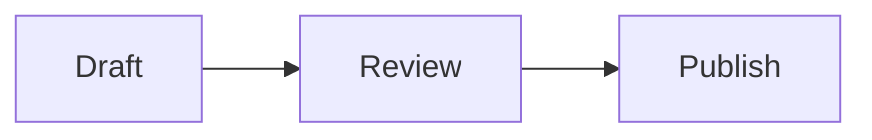

Use a converter that renders `mermaid` code fences as diagrams and highlights other fences by language, then save as PDF. A browser-based converter does both, printing diagrams as vector graphics and code as real text. Command-line tools such as Pandoc do not draw Mermaid on their own, so pre-render the diagrams to images first.

Both features depend on the same thing in your source: a fenced code block with the right language tag on the opening fence. A diagram must start with ` ```mermaid `; a code sample should start with its language, such as ` ```python ` or ` ```bash `. Without the tag, a converter has no way to know that the block is a diagram or which highlighting rules to use, and you get plain monospaced text. The [code block guide](/guides/markdown-code-block) covers fences, tags and indentation.

````markdown


```python
def publish(doc):
    return render(doc)
```
````

## How do I convert Markdown with Mermaid diagrams to PDF in the browser?

Open the [markdown to PDF converter](/markdown-to-pdf), paste your markdown or click **Open .md file**, and look at the preview. Each `mermaid` fence is drawn as a diagram, and each tagged code block is syntax-highlighted. Wait until every diagram has appeared in the preview (they render a moment after the text), then click **Download PDF** and choose **Save as PDF** in the print dialog. Everything happens in your browser; the document is not uploaded.

Diagrams are inserted as SVG, so they stay sharp at any zoom level in the PDF and their labels remain text. Flowcharts, sequence diagrams, class diagrams, Gantt charts and the other types that the Mermaid library supports all go through the same path.

## What happens if a Mermaid diagram has a syntax error?

The converter shows the diagram's source as a plain code block instead of a picture, both in the preview and in the PDF. That is your signal to fix the syntax: a missing arrow, an unclosed bracket or a keyword the diagram type does not accept are the usual causes. Check the preview before printing, because a broken diagram printed as code is easy to miss in a long document. The error is not reported line by line, so for a stubborn diagram, cut it down to two nodes and add lines back until it breaks.

## How are code blocks printed?

Code blocks print in a monospaced font on a light background with a thin border, and the PDF text stays selectable, so a reader can copy a command out of it. Keywords, strings and comments keep their highlight colours. The converter also asks the browser not to split a code block across two pages, so short and medium blocks move to the next page whole; a block longer than a page has to split, and does.

Two things to watch:

- **Long lines are cut off, not wrapped.** A line wider than the page runs past the right margin and is clipped in the PDF. Wrap lines in the source (about 80 characters fits portrait A4 or Letter comfortably), use a backslash continuation in shell commands, or switch the print dialog to landscape.
- **Untagged blocks get no colour.** Add the language to the fence. Indented code blocks (four spaces, no fence) cannot carry a tag at all, so convert them to fences; the [markdown formatter](/markdown-formatter) can help tidy a file before you do.

## Can Pandoc keep Mermaid diagrams?

Not on its own; Pandoc treats a `mermaid` fence as an ordinary code block and prints its source. The common fix is to pre-render diagrams with the official Mermaid CLI, which, per its [README](https://github.com/mermaid-js/mermaid-cli), can read a markdown file, render every Mermaid block to an image and write a new markdown file that refers to the images:

```bash
npx -p @mermaid-js/mermaid-cli mmdc -i report.md -o report-rendered.md -e png
pandoc report-rendered.md -o report.pdf
```

The `-e` option sets the image format (`svg`, `png` or `pdf`). The default is SVG; PNG is the safer choice when the PDF is produced through LaTeX, at the cost of a raster image. The Mermaid CLI renders through a headless Chromium browser, so the first run can be slow while it installs. Pandoc highlights code blocks by default, and its `--syntax-highlighting` option (`--highlight-style` in older versions) picks a colour style or turns highlighting off, as described in the [Pandoc manual](https://pandoc.org/MANUAL.html).

## Do Mermaid diagrams work when exporting from VS Code?

The VS Code preview renders Mermaid, and the Markdown PDF extension can include diagrams in its export, loading the Mermaid library from a CDN by default, so the export needs internet access. The full comparison of routes is in the guide to [exporting Markdown to PDF from VS Code](/markdown-to-pdf/vs-code-markdown-to-pdf).

## Will the diagram look the same as on GitHub?

Close, but not identical. GitHub renders `mermaid` fences in markdown files, issues and pull requests, and so do many editors, but each uses its own Mermaid version and theme. This converter uses a neutral grey theme, which prints well in black and white. Layout can differ slightly between Mermaid versions: node positions and line routing are computed each time, not stored in your source. If exact appearance matters, export the diagram once to SVG or PNG and embed that image instead of the fence; then every renderer shows the same picture.

## What can this converter not do with diagrams and code?

It cannot render PlantUML, Graphviz `dot` or other diagram languages; only Mermaid fences become pictures, and the rest print as code. Images referenced by a relative path such as `./diagram.png` do not load, because a web page cannot read files from your disk, so use an absolute `https://` URL. It does not render math written as `$...$`. It has no line numbers for code blocks and no way to choose the highlight theme or the font. Interactive features of Mermaid, such as clickable nodes, are switched off and could not work on paper anyway. To check how a file renders before converting it, the [markdown viewer](/markdown-viewer) shows the same rendering in a full page.

## Is a PDF the right format for diagrams and code?

For handing in, printing or archiving, yes. For code that people will copy and run, a PDF is a poor carrier: copying from a PDF can lose indentation or join lines, which breaks Python and YAML. Keep the markdown source alongside the PDF, or share a link to the rendered document so readers copy from the original text.
